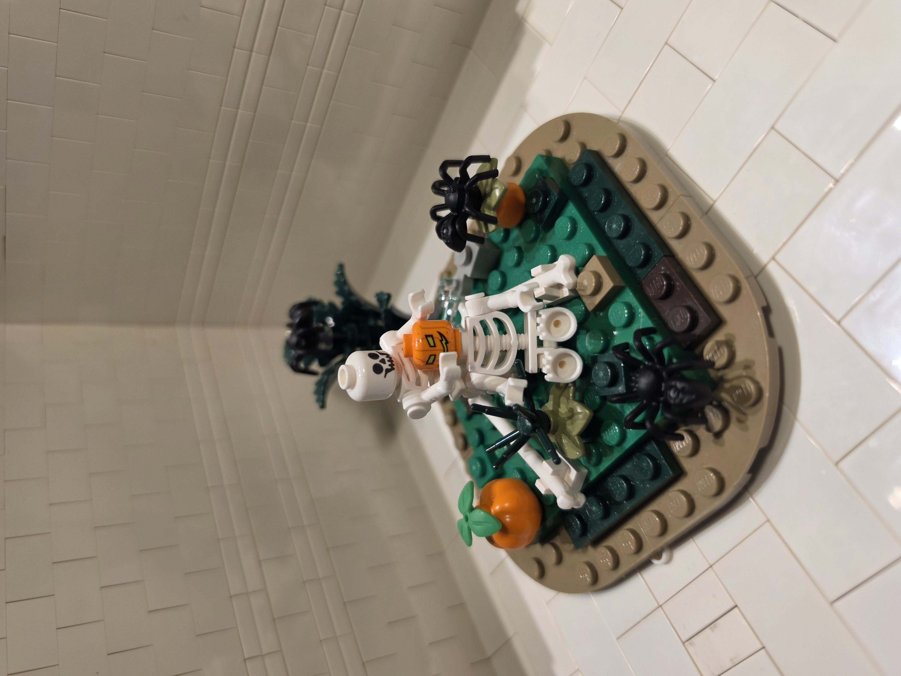
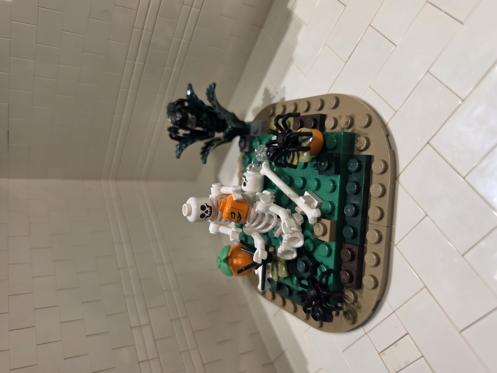
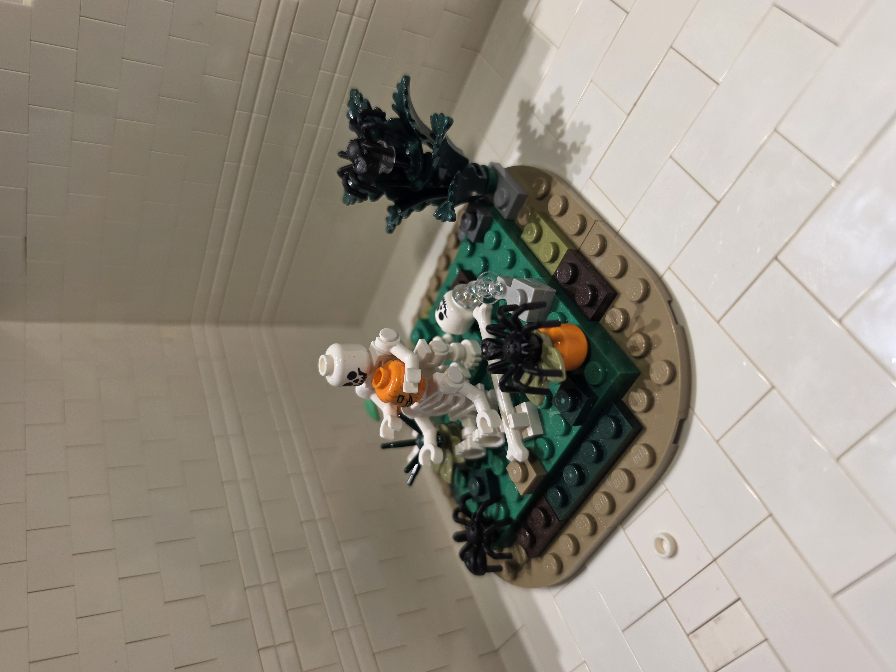
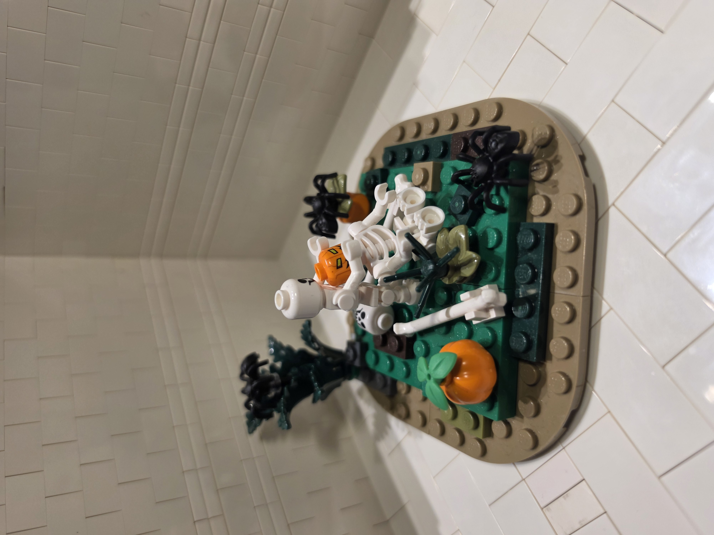
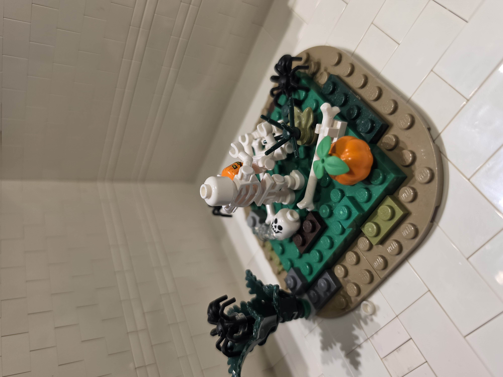
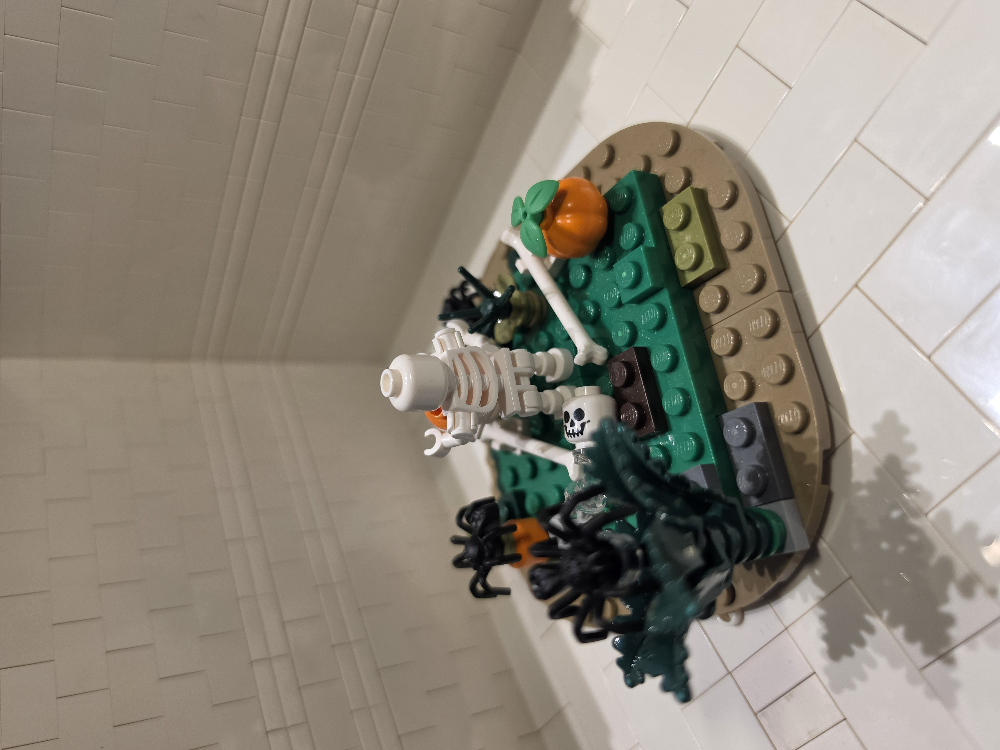
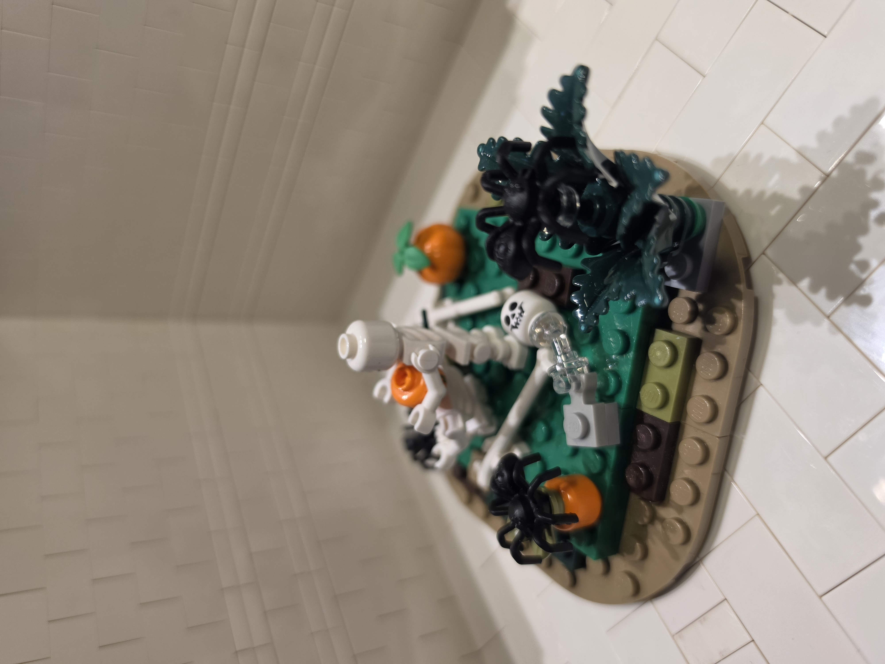

# Halloween Head Swap

In this small Halloween MOC, one skeleton gives another a new look by swapping its skull for a pumpkin. Pumpkins, scattered bones and spiders surround the pair.

## Photos

